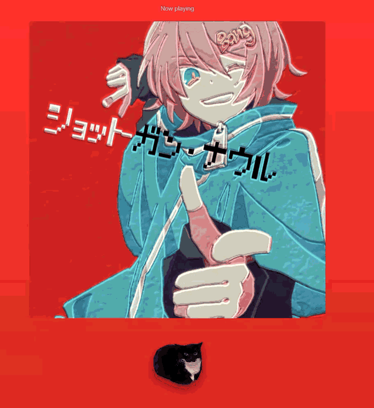
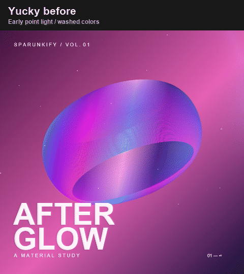
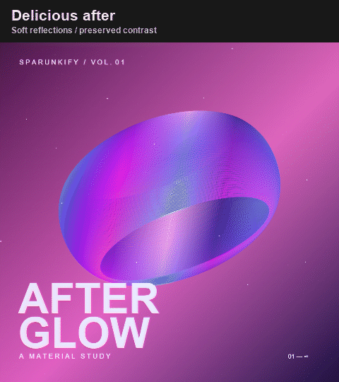

# Sparunkify

A Chrome extension that brings reflective album artwork and an optional audio-reactive Maxwell cat to Spotify Web Player and YouTube Music.



## Features

- Foil, gloss and embossed artwork finishes with adjustable relief and reflections.
- Artwork effects in Spotify's Now Playing sidebar and YouTube Music's album-art player, plus an expanded artwork view with pointer tilt.
- Optional Maxwell below the sidebar artwork and above the track details, with music-driven spin and squish.
- Automatic player detection with the same controls and saved settings on both services. No API keys or extra setup.
- Local settings and audio processing. No analytics.

## Built into the Web Player sidebar

Keep browsing Spotify while Sparunkify adds reflections and depth to the large album cover in the **Now Playing sidebar**. Maxwell has his own space below the cover, with the song title and artist visible underneath.

1. Play a track and open the Web Player's Now Playing sidebar so the large cover is visible.
2. Open the Sparunkify extension popup and enable **Show effects in player**.
3. Optionally enable **Maxwell below artwork** from that same Spotify tab. He spins and squishes to the music while staying below the cover.

The separate **Artwork** view is also available for a larger preview and finish adjustments.

## YouTube Music

1. Play a track at [music.youtube.com](https://music.youtube.com/) and open its player with the large album cover visible.
2. Open Sparunkify on that tab and enable **Show effects in player**.
3. Optionally turn on **Maxwell below artwork**. The same audio response and settings apply on both services.

There is no service selector. The popup follows your current music-player tab; from another tab it prefers an audible player. If neither player is open, it offers a button to open each service. **Open artwork view** also works when the large cover is hidden in the normal player. Video playback is left visible; inline effects use matching square artwork.

The YouTube Music artwork view fills the browser area and fits the cover, Maxwell and track details above a playback bar. Play/pause, skip tracks or seek without closing the view. **Full screen** hides the browser chrome; **Browse music** returns to YouTube Music. Maxwell stays below visible album art, or moves into a small dock above the native playback bar while you browse or watch a video. The dock's **Open artwork** button returns to the artwork view.

## Gross vs. Great

| Gross | Great |
| --- | --- |
|  |  |

Same demo artwork, settings and cursor path. Earlier renderer compared with the updated finish; recorded offline.

## Install

Requires Chrome 116 or later and Spotify Web Player or YouTube Music.

1. Download and extract the extension ZIP from [Releases](https://github.com/Toast1111/Sparunkify/releases), or clone this repository.
2. Open `chrome://extensions` and enable **Developer mode**.
3. Select **Load unpacked** and choose the folder containing `manifest.json`.
4. Refresh your music player, play a track, and select **Artwork**.

Use **Original** to compare the artwork, **Settings** to adjust its finish, and **Escape** to close the view. After an update, reload the extension and refresh your music player.

Turning **Maxwell below artwork** off releases tab-audio capture.

## Privacy and compatibility

Settings and audio processing stay on your device. See [Privacy](PRIVACY.md).

Supports Spotify Web Player and YouTube Music in Chrome. Background matching depends on Spotify's page layout; YouTube Music uses the artwork-color theme. Automated checks use controlled player fixtures. Artwork, title and artist detection have also been verified in a live YouTube Music tab; full-song audio and motion still need manual listening checks. Native desktop apps are not supported. Not affiliated with Spotify or YouTube.

## Development

Node.js 22 or later; no runtime dependencies or build step.

```sh
npm run check
npm test
npm run package
```

The extension ZIP is written to `dist/`. See the [development guide](docs/DEVELOPMENT.md) for browser checks, asset generation and release verification.

## Licensing

A project license has not been selected for the extension code.

[Maxwell the cat (Dingus)](https://sketchfab.com/3d-models/maxwell-the-cat-dingus-2ca7f3c1957847d6a145fc35de9046b0) by [bean(alwayshasbean)](https://sketchfab.com/alwayshasbean) is licensed under [CC BY 4.0](https://creativecommons.org/licenses/by/4.0/). Adapted and animated for Sparunkify. See [Third-party notices](THIRD_PARTY_NOTICES.md) and the [asset notes](assets/maxwell/README.md).
